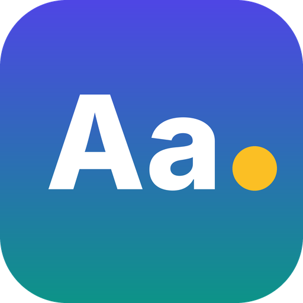

# App Name Finder

A Claude skill that turns an app idea into a shortlist of brandable names, each one paired with a domain you can actually register today.

Describe your idea ("a habit tracker for remote teams", "an AI tool that writes product descriptions for Etsy sellers") and Claude will:

1. **Clarify the idea** with one quick round of questions (audience, tone, naming style, which domain endings you accept), skipped when your description is already clear.
2. **Brainstorm ~40 names** across styles: compound words, metaphors, invented blends, altered words and root words.
3. **Filter hard**: too long, hard to spell when heard, hyphens/digits, too close to a known brand, bad meanings.
4. **Check domain availability** against the official registries, trying close variants (`get…`, `try…`, `…app`, `…hq`) when the `.com` is taken.
5. **Scan for conflicts**: a quick web search on the finalists for existing apps with the same name.
6. **Present a shortlist** with a top pick, availability status, naming style and reasoning, and iterate on your feedback.

It never presents an unchecked domain as available. If a domain can't be verified, it's marked "unverified" with a link to check it yourself.

## Install

### Claude Code

```
/plugin marketplace add MuhammedAbduRafi/app-name-finder
/plugin install app-name-finder@app-name-finder
```

Or copy `skills/app-name-finder/` into `~/.claude/skills/`.

### Claude.ai / Claude desktop (chat and Cowork)

Zip the `skills/app-name-finder` folder, then upload it under **Settings → Capabilities → Skills**.

## Usage

Just describe your app and ask for a name:

> I'm building an app that helps freelance designers track unpaid invoices and send polite reminders. Can you help me name it? I'd prefer a .com.

## How domain checking works

The skill uses [RDAP](https://about.rdap.org/), the official successor to WHOIS that domain registries run:

- `scripts/check_domains.py` (Python standard library only, no dependencies) downloads IANA's public list of registry RDAP servers, then asks the right registry about each domain. A record means **taken**, "not found" (HTTP 404) means **available**, and anything else is reported as **unknown**, never as available.
- When Claude can't run scripts, it fetches the same registry URLs with its web-fetch tool, using a known-registered domain as a control so that a blocked request isn't mistaken for availability.

### Network and privacy

The only data sent anywhere is the candidate domain names being checked. Requests go to:

- `data.iana.org`, for the public list of RDAP servers
- the official RDAP server for each TLD checked, for example Verisign (`.com`, `.net`), Google Registry (`.app`, `.dev`) and Identity Digital (`.io`)
- the DNS resolver configured on your machine, as a fallback signal

On top of that, Claude may run ordinary web searches on finalist names to look for existing apps. There are no API keys, analytics or tracking, and nothing is stored. Your app idea and conversation are never sent to these services. See the full [Privacy Policy](PRIVACY.md).

## Limitations

- "Available" means the registry has no record. Some unregistered names are reserved or sold at **premium prices**, so confirm the price at your registrar.
- Availability changes fast. Register a name you love soon.
- The conflict scan is a sanity check, **not a trademark search**. Check the USPTO, WIPO or your national trademark office before committing.
- Some TLDs (for example `.ai` and `.co`) may not be checkable from every environment. Those are flagged as unverified.

## Contributing

Issues and pull requests are welcome: better naming heuristics, more RDAP fallbacks, or test prompts.

## License

[MIT](LICENSE)
